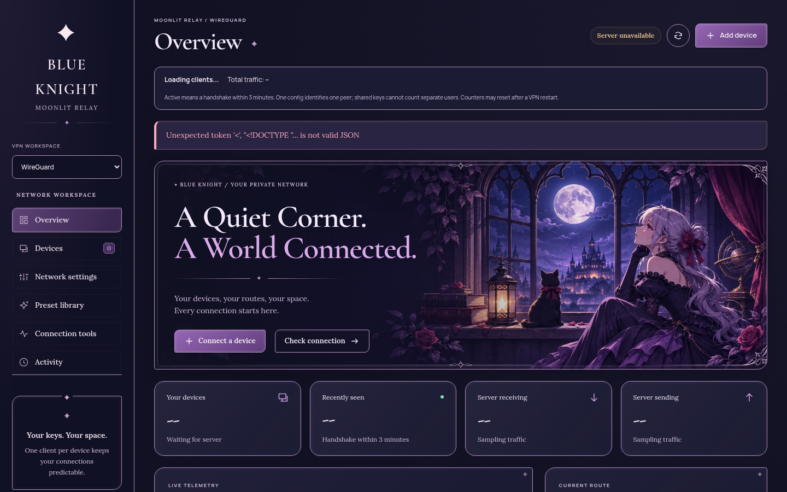
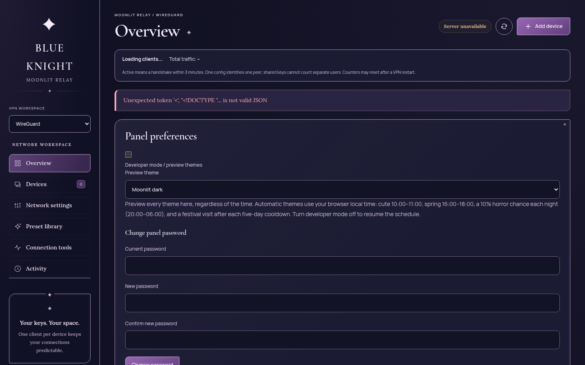
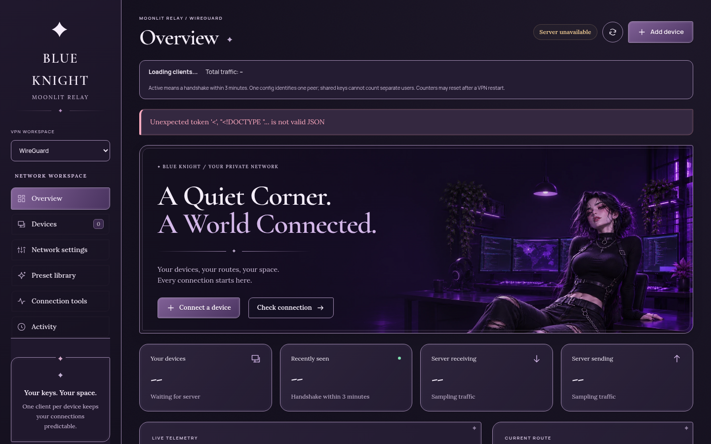

# Blue Knight WG Panel

[](https://github.com/BlueKnightNet/Blue-Knight-WG-Panel/releases)
[](https://github.com/BlueKnightNet/Blue-Knight-WG-Panel/pkgs/container/blue-knight-wg-panel)
[](https://github.com/BlueKnightNet/Blue-Knight-WG-Panel/pkgs/container/blue-knight-wg-panel)
[](LICENSE)

A self-hosted management panel for WireGuard and censorship-resistant AmneziaWG with automated Cloudflare WARP outbound routing. Designed for production VPS deployments, supporting native Linux kernel modules with automatic userspace failover.



---

## Key Features

- 🚀 Native WireGuard & AmneziaWG Inbound
- 🛡️ Standard AmneziaWG Obfuscation (Jc, Jmin, Jmax, S1, S2, H1–H4)
- 🌐 1-Click Cloudflare WARP Outbound Routing (`warp0`)
- 📦 Multi-Architecture Docker support (`linux/amd64` & `linux/arm64` on GHCR)
- 📱 1-Click QR Code & All-DNS ZIP Exports
- ⏳ Per-Device Data Quotas & Automated Expiry
- 🎨 Visual Themes (Moonlit Dark, Parchment Dawn, Gothic, etc.)

---

## Interface Overview

| Dashboard (Dark Theme) | Cloudflare WARP & Network Settings |
|:---:|:---:|
|  |  |

| Gothic Theme Preview |
|:---:|
|  |

---

## Quick Start (VPS Installer)

### System Requirements
- Ubuntu 20.04 / 22.04 / 24.04 or Debian 11 / 12
- Systemd init system with root or `sudo` privileges
- Public IPv4 address

### One-Line Installation

Run the following command on your VPS:

```bash
curl -fsSL https://raw.githubusercontent.com/BlueKnightNet/Blue-Knight-WG-Panel/blue-knight-net/install.sh -o /tmp/wg-auto-install.sh && sudo bash /tmp/wg-auto-install.sh
```

During installation, the script will detect your public IP, configure WireGuard, set up the panel service, and optionally prompt to install the native AmneziaWG kernel module.

### Firewall Configuration

Ensure the following ports are open in your VPS provider's security group / firewall:

| Port | Protocol | Purpose |
|:---|:---|:---|
| `8787` | TCP | Panel HTTPS Web Interface |
| `51820` | UDP | WireGuard VPN Endpoint (`wgauto0`) |
| `51821` | UDP | AmneziaWG VPN Endpoint (`awg0`) |

### Accessing the Web Panel

1. Open `https://YOUR_VPS_IP:8787` in your browser.
2. Accept the self-signed TLS certificate warning.
3. Sign in with username: **`admin`**.
4. Retrieve the auto-generated initial password on the server:
   ```bash
   sudo cat /etc/wireguard/wg-auto-panel/password
   ```
5. Update your administrative password under **Settings**.

---

## Native AmneziaWG Kernel Module

Blue Knight WG Panel implements a hybrid driver model:
1. **Kernel Module Priority**: If the host kernel has the `amneziawg` module installed, the panel operates directly through kernel space for maximum line-rate throughput and minimal CPU overhead.
2. **Userspace Engine Fallback**: If the host kernel module is absent, the panel transparently engages the embedded `amneziawg-go` userspace daemon without disrupting operations.

To achieve optimal performance, install the official [amnezia-vpn/amneziawg-linux-kernel-module](https://github.com/amnezia-vpn/amneziawg-linux-kernel-module) DKMS driver:

### Ubuntu (20.04, 22.04, 24.04)

```bash
sudo apt-get update
sudo apt-get install -y software-properties-common python3-launchpadlib gnupg2 "linux-headers-$(uname -r)"
sudo add-apt-repository -y ppa:amnezia/ppa
sudo apt-get update
sudo apt-get install -y amneziawg amneziawg-dkms
sudo modprobe amneziawg
```

### Debian (11, 12)

```bash
sudo apt-get update
sudo apt-get install -y software-properties-common python3-launchpadlib gnupg2 "linux-headers-$(uname -r)"
sudo apt-key adv --keyserver keyserver.ubuntu.com --recv-keys 57290828
echo "deb https://ppa.launchpadcontent.net/amnezia/ppa/ubuntu focal main" | sudo tee /etc/apt/sources.list.d/amnezia.list
echo "deb-src https://ppa.launchpadcontent.net/amnezia/ppa/ubuntu focal main" | sudo tee -a /etc/apt/sources.list.d/amnezia.list
sudo apt-get update
sudo apt-get install -y amneziawg amneziawg-dkms
sudo modprobe amneziawg
```

Verify that the kernel module is active:

```bash
lsmod | grep amneziawg
```

---

## Docker Deployment (GHCR)

Multi-architecture container images (`linux/amd64` and `linux/arm64`) are continuously built and published to GitHub Container Registry.

### Standalone Docker Run

```bash
docker run -d \
  --name blue-knight-panel \
  --restart unless-stopped \
  --cap-add=NET_ADMIN \
  --cap-add=NET_RAW \
  -v /dev/net/tun:/dev/net/tun \
  -v /etc/wireguard:/etc/wireguard \
  -v /etc/amnezia/amneziawg:/etc/amnezia/amneziawg \
  -v /opt/wg-auto:/opt/wg-auto \
  -p 8787:8787/tcp \
  -p 51820:51820/udp \
  -p 51821:51821/udp \
  ghcr.io/blueknightnet/blue-knight-wg-panel:latest
```

### Docker Compose

```yaml
services:
  blue-knight-panel:
    image: ghcr.io/blueknightnet/blue-knight-wg-panel:latest
    container_name: blue-knight-panel
    restart: unless-stopped
    cap_add:
      - NET_ADMIN
      - NET_RAW
    devices:
      - /dev/net/tun:/dev/net/tun
    volumes:
      - /etc/wireguard:/etc/wireguard
      - /etc/amnezia/amneziawg:/etc/amnezia/amneziawg
      - /opt/wg-auto:/opt/wg-auto
    ports:
      - "8787:8787/tcp"
      - "51820:51820/udp"
      - "51821:51821/udp"
```

*Note: For the container to utilize native kernel acceleration, install the DKMS module on the host server prior to starting the container.*

---

## Cloudflare WARP Outbound Routing

Blue Knight WG Panel supports dual-hop egress routing via Cloudflare WARP (`warp0`). When enabled:
- Clients connect to your VPS over WireGuard or obfuscated AmneziaWG.
- The VPS proxies egress traffic through Cloudflare's global edge network via an automated `warp0` WireGuard tunnel.
- Destination websites observe Cloudflare clean IP ranges, safeguarding your VPS hosting IP from geolocation bans and reputation flags.

Toggle this functionality on demand under **Network Settings > Cloudflare WARP Outbound**.

---

## Device Quotas & Expiration

Each client profile can be configured with strict bandwidth and lifespan limits:
- **Data Limit (GiB)**: Cumulative bidirectional traffic threshold. Setting `0` grants unlimited usage.
- **Expiry Date**: Automatic decommission timestamp synchronized with browser local time.
- **Enforcement Loop**: The panel daemon polls active interfaces every 5 seconds. When a device exhausts its allocated quota or passes its expiry date, its public key is revoked from the active interface immediately. Increasing the quota or extending the date instantly restores tunnel access.

---

## Updates

To update an existing installation to the latest release:

```bash
sudo wg-auto-update
```

If updating from an earlier fork or legacy installation, bind the updater script to this repository once:

```bash
curl -fsSL https://raw.githubusercontent.com/BlueKnightNet/Blue-Knight-WG-Panel/blue-knight-net/update.sh -o /tmp/wg-auto-update.sh
sudo bash /tmp/wg-auto-update.sh --install
```

All existing client keys, routing parameters, and administrative credentials are preserved across updates.

---

## Service Management & Troubleshooting

Diagnose system services and interfaces using standard systemd and WireGuard tooling:

```bash
# Check panel service status
sudo systemctl status wg-auto-panel --no-pager

# Inspect active WireGuard peers and handshakes
sudo wg show wgauto0

# Inspect active AmneziaWG peers and handshakes
sudo awg show awg0

# View real-time panel service logs
sudo journalctl -u wg-auto-panel -n 50 -f
```

---

## Uninstallation

### Bare-Metal and Systemd Deployments

To remove Blue Knight WG Panel, systemd units, network interfaces, and binaries, run the uninstallation script:

```bash
sudo ./uninstall.sh
```

Alternatively, invoke the uninstaller through the installer:

```bash
sudo ./install.sh --uninstall
```

To execute uninstallation with a single remote command:

```bash
curl -fsSL https://raw.githubusercontent.com/BlueKnightNet/Blue-Knight-WG-Panel/blue-knight-net/uninstall.sh | sudo bash
```

Available uninstallation flags:
- `--purge`: Delete all client configurations, keys, and credentials (`/etc/wireguard`, `/etc/amnezia`, and `/root/wireguard-client.conf`).
- `--dry-run`: Simulate uninstallation steps without deleting files or changing system state.
- `-y`, `--yes`, `-f`, `--force`: Execute non-interactively without confirmation prompts.

Example with full purge and non-interactive execution:

```bash
sudo ./uninstall.sh --yes --purge
```

### Docker Deployments

Docker container deployments do not use `uninstall.sh`. Manage container removal directly with Docker Compose:

Stop and remove panel containers:

```bash
docker compose down
```

To remove all persistent volumes and data directories:

```bash
docker compose down -v
```

---

## Development

```bash
# Compile and package web assets into panel.html
python3 build_panel.py

# Execute test suite
python3 -m unittest -v test_panel test_local_app
```

UI source assets reside in `web/`. When modifying frontend logic, run `python3 build_panel.py` to regenerate the production `panel.html` template.

---

## License

This project is licensed under the [MIT License](LICENSE).
